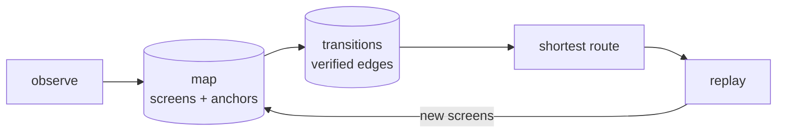
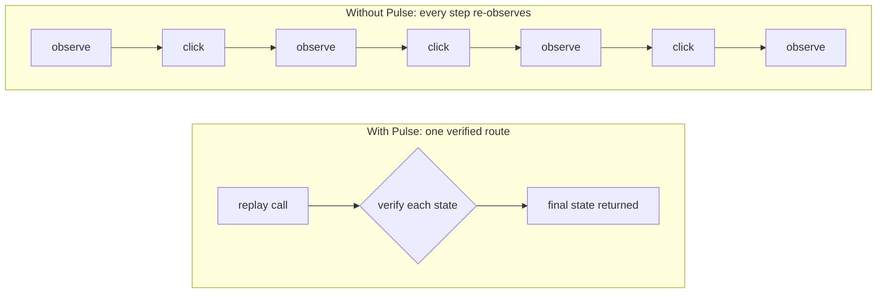
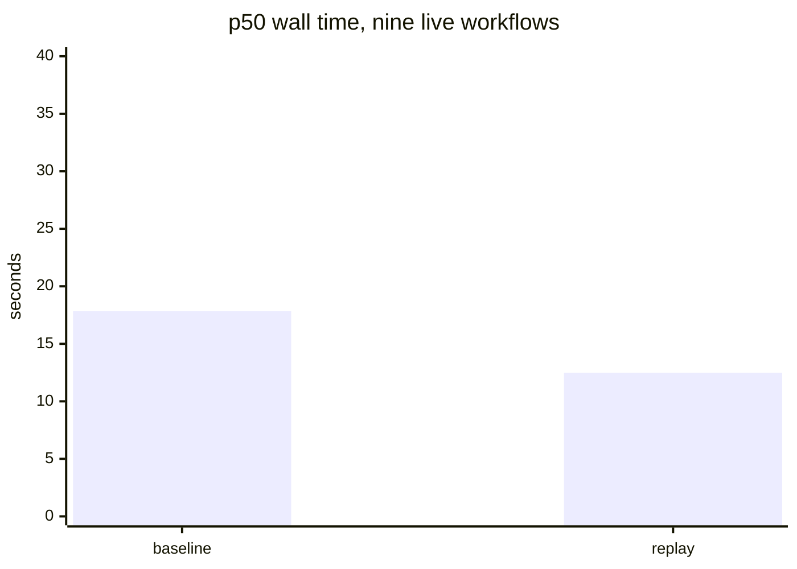

# Pulse

A screen map and verified-workflow store for computer-use agents.

Pulse records what a page or desktop looks like. It connects screens with
transitions it watched succeed. Then it replays a whole route in one call.

Python MCP server. No runtime dependencies.

## The problem

An agent driving a UI pays the same cost on every step. Observe, decide, click,
observe again to confirm. A route it solved yesterday is solved from scratch
today.

Pulse keeps the map between runs. The learned route replays as one call, and the
replay still verifies every state it crosses.



## With Pulse and without



The saving tracks how much observation a route removes. Six guarded clicks
become one call. A single click saves one screenshot digest and nothing else.

## Measured results

Every number below comes from `docs/benchmark.md`, on local fixtures and public
sites, on 2026-10-24.

### One call against many

| Workflow | Baseline | Replay | Saved | Evidence |
| --- | ---: | ---: | ---: | --- |
| 6 clicks, in process | 4,328 ms | 1,177 ms | 72.8% | 3 trials each |
| 3 clicks, in process | 309.0 ms | 95.9 ms | 69.0% | 7 trials each |
| 2 desktop clicks | 3,364.9 ms | 1,047.7 ms | 68.9% | 7 trials each |
| 4 transitions, model in loop | 42.76 s | 17.39 s | 59.3% | 3 paired trials |

### Whole workflows, live sites

| Workflow | Calls | Baseline | Replay | Change |
| --- | ---: | ---: | ---: | ---: |
| Add two elements | 2 → 1 | 751 ms | 177 ms | −76.4% |
| Toggle a checkbox | 1 → 1 | 440 ms | 231 ms | −47.4% |
| Scroll a long page | 1 → 1 | 364 ms | 275 ms | −24.4% |
| Complete a todo | 3 → 3 | 903 ms | 773 ms | −14.5% |

### Nine workflows through each harness

| Harness | Baseline p50 | Replay p50 | Speed increase | Runs |
| --- | ---: | ---: | ---: | ---: |
| Claude Code | 17.83 s | 12.49 s | 42.8% | 35/35 correct |
| Codex | 34.55 s | 23.00 s | 50.2% | 36/36 correct |

The six-click workflow alone speeds up 278.2% through Claude Code and 276.2%
through Codex. Both harnesses hit that target on sequential work. Neither
reaches it on random or single-step requests.

### The same runs inside agent desktops

Each harness ran in its own pane, on its own agent desktop, with its own
Chromium profile, CDP port and Pulse state per trial. The host focus never moved.

| Workflow | Harness | Baseline p50 | Replay p50 | Speed increase | Runs |
| --- | --- | ---: | ---: | ---: | ---: |
| Six clicks | Claude Code | 49.97 s | 17.38 s | 187.5% | 4/4 correct |
| Six clicks | Codex | 85.03 s | 23.35 s | 264.2% | 4/4 correct |
| Two categories | Claude Code | 19.73 s | 14.57 s | 35.3% | 4/4 correct |
| Two categories | Codex | 36.45 s | 26.15 s | 39.4% | 4/4 correct |

Nine workflows ran in the same conditions. Nine workflows moved the overall p50
from 28.94 s to 18.64 s through Claude Code, a 55.3% speed increase. Nine
workflows moved 39.40 s to 26.43 s through Codex, 49.1%. Nine workflows include
six clicks at 354.1% and 256.4%, two Claude regressions, and two Codex refusals
that stopped on a stale start screen rather than acting. Every trial recorded
`deepseek/deepseek-v4.1-flash-ultrafast` in its own row. The per-workflow table
is in [docs/benchmark.md](docs/benchmark.md).



## Good cases

Pulse pays for itself when a route removes observation.

| Case | Why it gains | Measured |
| --- | --- | --- |
| Many sequential steps | one guarded step leaves per transition | 6 clicks: 72.8% saved in process, 278.2% faster in Claude |
| A route you run again | learning cost spreads over every rerun | nine workflows: 42.8% and 50.2% |
| Deterministic DOM | screen ids match across runs | most workflows 2/2 or 3/3 |
| Desktop with a settled tree | accessibility map replaces screenshots | 68.9% saved over 2 clicks |

## Base cases

Pulse gains little or nothing here. Each limit has a reason.

| Case | Why it does not gain | Measured |
| --- | --- | --- |
| A single step | both paths observe twice, so a route saves one digest | scroll: 25.0% slower in Claude |
| A short workflow | the CLI launch floor, 5.7 s Claude and 11.4 s Codex, dominates | two clicks: 23.3% faster |
| A page typed value reappears on | the page renders the value as mapped text | TodoMVC |
| Lazy-loading content | settled height differs per run | replay stopped 1/3, then 3/3 after a settle wait |
| Action reported only in a `<p>` | no mapped anchor changes, so no edge forms | demoqa buttons |

Replay pays one settle wait per step. Replay pays 631 ms for the call wrapping a
4.6 ms read. Replay needs that wait to record an async step correctly, so the
cost is a correctness decision rather than a tuning knob.

## Install

```sh
python3 -m pip install -e .
pulse-mcp
```

The default data directory is `~/dev/pulse-data` when `~/dev` exists. Otherwise
it is `$XDG_STATE_HOME/pulse`, or `~/.local/state/pulse`. Set `PULSE_STATE_DIR`
to choose another directory.

## Connect

Pulse speaks MCP over stdio. `pulse-mcp` reads JSON-RPC on stdin and writes it
on stdout, so each client launches its own child process. Pulse opens no port
and runs nothing between sessions.

```sh
claude mcp add --scope user pulse -- pulse-mcp
```

```toml
# ~/.codex/config.toml
[mcp_servers.pulse]
command = "pulse-mcp"
```

Restart the harness after adding the server. Both harnesses expose the same
tools.

## Tools

| Tool | Purpose |
| --- | --- |
| `pulse_map_record_screen` | Save an observation, return its grid |
| `pulse_map_record_transition` | Save an edge, verified or not |
| `pulse_map_get` | Read a map, or one screen with its grid |
| `pulse_map_route` | Shortest route over verified edges |
| `pulse_routine_save` / `list` / `get` | Save and read routine candidates |
| `pulse_browser_observe` | Map visible controls in a local Chromium tab |
| `pulse_browser_targets` | List tabs on one CDP port, and which a call picks |
| `pulse_browser_click` | Click a mapped control after a stale-screen check |
| `pulse_browser_fill` | Type into one mapped field, guarded, no implicit submit |
| `pulse_browser_key` | Send `enter` or `escape` to the focused element |
| `pulse_browser_scroll` | Scroll a bounded delta and re-map |
| `pulse_browser_replay` | Run a verified route in one call |
| `pulse_desktop_observe` | Map a Linux desktop from accessibility and screenshots |
| `pulse_desktop_click` | Click a mapped desktop control, guarded |
| `pulse_desktop_replay` | Run a verified desktop route |

Anchor bounds are normalized. `x`, `y`, `width` and `height` each use the
viewport as a 0–1 scale, and an anchor sits in the grid cell holding its center.
An edge becomes route-eligible only after it is seen to change screen state.

## Start a browser

```sh
chromium --headless=new --no-sandbox --remote-debugging-port=9222 \
  --user-data-dir=/tmp/pulse-chromium about:blank
```

The default port is 9222. Tools can pass another local port, or set
`PULSE_CDP_PORT`. Connect only a browser profile you intend an agent to control.

A call without `target_url` takes the newest page target, which may not be the
page under test. A call with `target_url` stays on the tab it names. A call
should follow `pulse_browser_targets` when one port serves several tabs, because
that tool reports what the port holds and which tab a call would pick. A call
that captures a stalled background tab reports no digest, and the observation
still returns its anchors.

## What a map holds

| Holds | Never holds |
| --- | --- |
| roles, labels, selected state | form values |
| normalized bounds, viewport size | screenshot bytes |
| screenshot digest | URL query or fragment |

Map files are written atomically with owner-only permissions. A fill keeps its
value out of every map, tool result and saved routine. A fill reports only the
length it typed. A fill refuses password, file, hidden, checkbox, radio,
disabled and read-only fields. A fill confirms by reading the field back, and
sends no key, so it cannot submit.

Two rules govern focus and line endings:

- A fill drops focus once it confirms, because a focused field's text reaches
  the next observation's anchor labels. Pass `keep_focus` before
  `pulse_browser_key`.
- A single-line field loses a trailing newline, so the entry is trimmed and
  confirmed against the trimmed text.

A scroll position takes part in the screen id. Two positions in one long page
therefore have separate ids, and a stale-screen check cannot pass wrongly.

**The fill guard has one leak.** A value reaches the map when the page displays
it. A value arrives as an anchor label like any other text. A value cannot be
redacted without dropping real page content. A value never belongs in a secret
field the page shows, and TodoMVC shows exactly that: a typed title becomes the
row's checkbox label.

## Desktop

The desktop adapter reads `computer-use-linux` accessibility snapshots and
screenshots. The desktop adapter places accessible elements on the same
normalized grid. The desktop adapter needs `computer-use-linux mcp` on `PATH`,
and `PULSE_COMPUTER_USE_BIN` picks a specific binary. The desktop adapter calls
Tesseract only to place a control whose accessibility bounds are missing.
Browser routes and desktop routes share one planner.

## Limits

Pulse does not execute saved routines in this version. Routine steps reject
literal values, so a step carries an `input_ref` and a future driver supplies
the value.

A paragraph is not mapped. A page that reports an action only in a `<p>` changes
no screen id, so the map looks unchanged and no route learns.

## Development

```sh
PYTHONPATH=src python3 -m unittest discover -s tests -v
python3 -m compileall -q src tests
```

Results, the four defects live sites exposed, and the scope of each number are
in [docs/benchmark.md](docs/benchmark.md).
